# DistrictWatch — Tactical Incident & Administrative Early Warning System
**Hackathon Prototype Blueprint & Technical Implementation Plan**

---

## 1. Executive Summary & Vision

**DistrictWatch** is an interactive, map-centric administrative command and early warning platform engineered for municipal authorities, disaster response teams, and local citizens. 

While inspired by tactical situational awareness tools (often termed "God's Eye"), DistrictWatch differs significantly by focusing on **civic governance, multi-tiered emergency response, utility failure tracking, and rapid bi-directional public communication**.

### Core Differentiators:
- **Comprehensive Incident Spectrum:** Extends beyond military/security tracking to encompass **natural disasters** (floods, earthquakes, storms), **critical civic disruptions** (water grid failures, blackouts, gas leaks, road cave-ins), and **public safety advisories** (curfews, chemical hazards, amber alerts).
- **Dual Perspective HUD:**
  - **Command Center Mode (Authorities/Admin):** Threat assessment, affected population radius analytics, geo-targeted alert dispatch, and emergency unit tracking.
  - **Citizen Sanctuary Mode (Public View):** "Am I in danger?" radius scanner, real-time safety advisories, verified emergency shelters/helplines, and a crowdsourced incident report intake.
- **Simulated Real-Time Engine:** Autonomous time ticker, dynamic incident progression (e.g., flood waters expanding over time), and a simulated broadcast pipeline showing mock SMS/Email/Siren activation metrics.

---

## 2. User Personas & Core Journeys

| Persona | Primary Goal | Key Workflows |
| :--- | :--- | :--- |
| **District Disaster Officer (Admin)** | Triage disasters, coordinate resources, broadcast mass warnings. | Inspect live map layers, select hazard zone, simulate emergency SMS/Email push to 40,000+ residents, monitor shelter occupancy. |
| **Municipal Works Engineer** | Track infrastructure and utility failures. | Map water pipeline ruptures or power grid blackouts, isolate affected sub-stations, update ETA to restoration. |
| **Local Resident / Citizen** | Stay informed, find safe zones, report hyper-local hazards. | Pinpoint home location, check active radius alerts, navigate to nearest dry shelter, submit downed power line report. |
| **Hackathon Judge / Observer** | Evaluate technical viability, design elegance, and scalability. | Toggle live scenario presets ("Flash Flood Surge", "Multi-Utility Blackout"), trigger simulated alerts, inspect analytics. |

---

## 3. High-Level Architecture & Tech Stack Recommendation

### Recommended Stack (Local Prototype -> Vercel/Supabase Ready):
- **Core Framework:** **Vite + React (TypeScript)**
  - *Why:* Instant HMR, zero build overhead, structured component hierarchy, TypeScript interfaces ensure rock-solid data modeling for future agents.
  - *Alternative:* Next.js App Router (if SSR is needed, but Vite is faster for pure prototype frontend and deploys seamlessly to Vercel).
- **Mapping & GIS Engine:** **Leaflet + React-Leaflet** (or **MapLibre GL / Mapbox GL**)
  - Clean OpenStreetMap integration (no billing/API keys required), high performance vector polygon rendering for flood zones and outage clusters, custom SVG tactical markers and pulsing threat rings.
- **Styling & Design System:** **Tailwind CSS + Custom Modern CSS Design Tokens**
  - High-performance glassmorphism, responsive grid layouts, custom radar pulses, dark tactical HUD theme.
- **Icons & Visuals:** **Lucide React** (Tactical, civic, weather, utility icons).
- **State & Simulation Engine:** **Zustand** or **React Context + Reducer**
  - Manages the master timeline clock (1x, 5x speed, pause), active incident states, mock notification logs, and user filtering.
- **Data Persistence (Roadmap):**
  - **Current Phase:** In-memory structured mock data store with dynamic event generators.
  - **Future Phase:** Supabase (PostgreSQL + PostGIS for spatial geo-queries, Supabase Realtime for WebSockets, Row Level Security for admin vs public).

---

## 4. System Modules & Functional Specifications

```mermaid
graph TD
    A[DistrictWatch Core Platform] --> B[Interactive GIS Map Engine]
    A --> C[Command Center & Incident Triage]
    A --> D[Alert Broadcast Pipeline Simulator]
    A --> E[Citizen Portal & Safety HUD]
    A --> F[Real-Time Analytics & Telemetry]
    A --> G[Simulation Controller & Scenario Injector]

    B --> B1[Hazard Heatmaps & Danger Radii]
    B --> B2[Utility Outage Grids]
    B --> B3[Emergency Shelters & Hospitals]

    C --> C1[Incident Creation Modal]
    C --> C2[Severity Triage: Low/Mod/High/Critical]
    C --> C3[Resource Deployment Dispatch]

    D --> D1[Geo-Fenced Mass SMS/Email Blast]
    D --> D2[Siren Network Simulation]
    D --> D3[Delivery Rate & Confirmation Ticker]

    E --> E1['Am I Safe?' Geolocation Scanner]
    E --> E2[Shelter Directions & Helplines]
    E --> E3[Citizen Hazard Incident Report Form]

    F --> F1[Estimated Affected Population]
    F --> F2[District Risk Severity Score]
    F --> F3[Hospital Bed & Shelter Capacity Tracker]

    G --> G1[Play / Pause / Speed Controller]
    G --> G2[Pre-baked Scenarios: Flood, Cyclone, Blackout]
```



### Module 1: The Interactive GIS Map Engine
- **Dark Tactical Basemap:** High-contrast tiles (CartoDB Dark Matter / Alidade Smooth Dark) emphasizing glowing incident markers.
- **Dynamic Overlays:**
  - *Disaster Zones:* Red/Amber translucent polygons with animated pulse waves (e.g., flood inundation boundaries, earthquake epicenters).
  - *Utility Failure Corridors:* Purple line paths / polygons representing disconnected electrical feeders or drained water mains.
  - *Road Closures:* Red dashed lines indicating blocked arteries with detour advisories.
  - *Critical Infrastructure Nodes:* Markers for operational hospitals, active relief shelters, and siren towers.
- **Interactive Marker Clustering & Detail Drawer:** Clicking any incident or asset slides open a high-density tactical dossier with telemetry, timestamps, severity, and action buttons.

### Module 2: Administrative Command Center & Incident Triage
- **Incident Feed & Quick Filters:** Filter by type (*Natural Disaster*, *Civic Outage*, *Public Safety*, *Infrastructure*), severity (*Advisory*, *Watch*, *Warning*, *Emergency*), and status (*Active*, *Contained*, *Resolved*).
- **Incident Creation / Geotargeting:** Admin can click anywhere on the map or type coordinates to spawn a new alert zone with custom radius, type, and advisory notice.
- **Resource Allocation:** Track status of emergency responders (Fire, Ambulance, Flood Rescue Boats, Grid Repair Crews).

### Module 3: Alert Broadcast Simulator (Mass Notification Engine)
- **Targeting Mechanics:** Admin specifies broadcast zone (e.g., "Ward 4 & 5 - Within 3.5 km of Riverbank").
- **Multi-Channel Dispatch Simulator:**
  - **SMS Blast:** Simulated throughput (e.g., 42,500 messages dispatched, 99.4% delivery simulation).
  - **Emergency Push Notification:** Lock-screen preview with siren sound effect toggle.
  - **Siren / Public Address:** Visual activation of siren tower icons on the map.
  - **Automated Email Advisory:** High-priority PDF/HTML digest simulation.
- **Live Transmission Feed:** Real-time log showing message dispatch velocity and carrier ack simulation.

### Module 4: Citizen Sanctuary Mode (Public UI View)
- **Single-Click Switcher:** Top bar toggle between "Command View (Admin)" and "Resident View (Citizen)".
- **Resident Status Card:**
  - Automatically assesses nearest hazard based on selected or detected pin.
  - Clear indicator: **"STATUS: MONITOR / EVACUATE / NORMAL"**.
- **Actionable Survival Checklist:** Contextual instructions (e.g., "Turn off gas mains", "Boil water notice active", "Proceed to Community Center B").
- **Incident Crowdsource Reporting:** Easy modal for citizens to submit hazards (e.g., fallen tree, waterlogging, sparking transformer) with simulated photo attachment and location tagging.

### Module 5: Real-Time Telemetry & Analytics Dashboard
- **Key Performance Indicators (KPIs):**
  - **Current Threat Index (1-100):** Algorithmic composite score based on active disaster severities.
  - **Estimated Population at Risk:** Dynamic calculation based on overlapping incident radii.
  - **Active Outage Counters:** Households without power / water.
  - **Shelter Readiness:** % capacity utilized across district shelters.
- **Live Event Ticker:** Bottom or side scrolling ticker showing real-time timestamps of updates, reports, and team deployments.

### Module 6: Simulation Controller (Demo Mode for Judges)
- **Time Controls:** Play, Pause, Fast-forward (1x, 2x, 5x) to demonstrate how incidents unfold over hours.
- **Instant Hackathon Demos (Preset Scenarios):**
  1. *Scenario 1: "The Monsoon Inundation"* — Flash flood warning triggers -> River level rises -> Road bridge closes -> 35,000 citizens alerted -> Shelters activate.
  2. *Scenario 2: "Grid & Pipeline Cascade"* — Heavy storm damages transformer -> 4 wards lose power -> Water pump stations fail -> Water outage notice dispatched.
  3. *Scenario 3: "Hazmat / Chemical Leak"* — Industrial zone gas leak -> Wind direction vector overlay -> Evacuation radius calculated -> Automated public sirens enabled.

---

## 5. UI/UX Design System ("Aegis Dark" Tactical Aesthetic)

To guarantee a memorable impression on hackathon judges, the UI will adhere to a unified, cyber-command aesthetic:

- **Color Palette:**
  - `Background Dark:` Deep Space Slate (`#0B0F17`, `#111827`)
  - `Panel / Card Surface:` Glassmorphic dark slate with border glow (`#1E293B` at 70% opacity, `backdrop-blur-md`, subtle border `#334155`)
  - `Emergency / Disaster (Red):` Vibrant Crimson Alert (`#EF4444`, glow `rgba(239,68,68,0.4)`)
  - `High Alert / Weather (Amber/Orange):` Radiant Warning (`#F59E0B`, glow `rgba(245,158,11,0.4)`)
  - `Civic & Utilities (Purple/Cyan):` Tech Violet (`#8B5CF6`) & Electric Cyan (`#06B6D4`)
  - `Safe / Operational (Green):` Emerald Operational (`#10B981`)
- **Typography:**
  - Modern sans-serif headers (`Inter` or `Plus Jakarta Sans`) paired with monospace numeric telemetry counters (`JetBrains Mono` or `Fira Code`) for tactical coordinates and population counts.
- **Micro-Animations & Effects:**
  - Radar sweep / pulse rings radiating from high-severity epicenters.
  - Glowing status pills with breathing LED dots (`animate-pulse`).
  - Smooth slide-out inspection drawers and modal transitions.

---

## 6. Data Models & Mock Schema Blueprint

```typescript
// Core Data Contracts for DistrictWatch

export type IncidentCategory = 
  | 'NATURAL_DISASTER'   // Floods, Earthquakes, Wildfires, Storms
  | 'CIVIC_UTILITY'       // Power outage, Water cut, Gas leak, Sewage
  | 'INFRASTRUCTURE'      // Road blockage, Bridge closure, Rail disruption
  | 'PUBLIC_SAFETY';      // Curfew, Chemical hazard, Public advisory

export type SeverityLevel = 'ADVISORY' | 'WATCH' | 'WARNING' | 'CRITICAL_EMERGENCY';

export type IncidentStatus = 'ACTIVE' | 'CONTAINED' | 'EVALUATING' | 'RESOLVED';

export interface GeoLocation {
  lat: number;
  lng: number;
  address?: string;
  wardOrDistrict?: string;
}

export interface IncidentRecord {
  id: string;
  title: string;
  category: IncidentCategory;
  subType: string; // e.g., "Flash Flood", "High-Voltage Cable Down"
  severity: SeverityLevel;
  status: IncidentStatus;
  location: GeoLocation;
  radiusMeters: number; // For circular danger zones
  polygonCoordinates?: [number, number][]; // For irregular flood or ward zones
  estimatedImpactedPopulation: number;
  reportedAt: string;
  updatedAt: string;
  description: string;
  recommendedAction: string;
  officialSource: string;
  metrics?: {
    waterLevelMeters?: number;
    powerOutageCustomers?: number;
    windSpeedKmh?: number;
    roadClosureLengthKm?: number;
  };
}

export interface EmergencyShelter {
  id: string;
  name: string;
  location: GeoLocation;
  capacityTotal: number;
  capacityOccupied: number;
  suppliesStatus: 'ADEQUATE' | 'CRITICAL' | 'RESTOCKING';
  contactPhone: string;
  isOpen: boolean;
}

export interface BroadcastAlert {
  id: string;
  incidentId: string;
  timestamp: string;
  targetWards: string[];
  channels: ('SMS' | 'EMAIL' | 'PUSH' | 'SIREN')[];
  headline: string;
  bodyText: string;
  stats: {
    recipientsCount: number;
    deliveryRatePercent: number;
    sirensTriggeredCount: number;
  };
}
```

---

## 7. Phased Implementation Roadmap

### **Phase 1: Foundation & Project Bootstrapping**
- Confirm stack choice with user (e.g., Vite + React + Tailwind + Leaflet).
- Initialize clean workspace with organized directory structure (`/components`, `/data`, `/store`, `/types`, `/hooks`).
- Establish global design tokens, CSS variables, and dark glassmorphic styling baseline.

### **Phase 2: Tactical GIS Engine & Map Integration**
- Integrate OpenStreetMap / Leaflet with tactical dark skin.
- Implement custom reactive SVG map markers (pulsing pins, category icons).
- Render polygon hazard boundaries and radius danger circles with interactive click popups.
- Add zoom/pan controls, layer toggles (Weather radar layer, Utility grid layer, Safe zones layer).

### **Phase 3: Command Center HUD & Data Feeds**
- Build collapsible top telemetry navigation bar (Threat Level, Population Affected, Active Outages, Live UTC Clock).
- Build the Left Tactical Sidebar: Search, filters by category/severity, and real-time incident cards.
- Build the Right Inspection Drawer: Comprehensive telemetry breakdown, impacted wards, incident timeline, and dispatch actions.

### **Phase 4: Alert Broadcast Simulator & Incident Creator**
- Build the "Dispatch Emergency Alert" workflow:
  - Geo-target selector on map.
  - Multi-channel delivery checkboxes (SMS, Push, Public Siren, Email).
  - Simulated live transmission animation with delivery counter.
- Build the "Log New Incident" administrative modal for live demo creation during judging.

### **Phase 5: Citizen Sanctuary Mode & Crowdsourced Intake**
- Build the toggleable Citizen Portal overlay:
  - "Check My Neighborhood" search / pin drop.
  - Dynamic hazard proximity calculator (e.g., "1.2 km away from active flood zone").
  - Shelter locator with capacity bars and direct directions.
  - Citizen Incident Submission form (with mock file upload and instant appearance on admin map).

### **Phase 6: Simulation Engine, Scenario Presets & Polish**
- Add the Simulation Bar (Play / Pause / 1x / 5x / Scenario selector: *Monsoon Surge*, *Power Grid Cascade*, *Hazmat Alert*).
- Sound effects toggle (subtle emergency chirp / siren audio using web audio synth for wow factor).
- Hackathon polish: micro-interactions, responsive mobile/tablet layout support, zero console errors.

---

## 8. Multi-Agent & Model Switching Protocols

- **State of Truth:** This `implementation.md` is the authoritative blueprint. Any model (Gemini 3.1 Pro, 3.8 Flash, etc.) resuming work must check this document first.
- **Git Checkpoint Hygiene:** Every phase must conclude with a verifiable, cleanly committed Git state with descriptive commit messages.
- **Strict User Consent Rule:** **NO CODE FILES OR DIRECTORIES ARE MODIFIED OR CREATED WITHOUT EXPLICIT PERMISSION FROM THE USER.** All architectural revisions must be approved beforehand.
